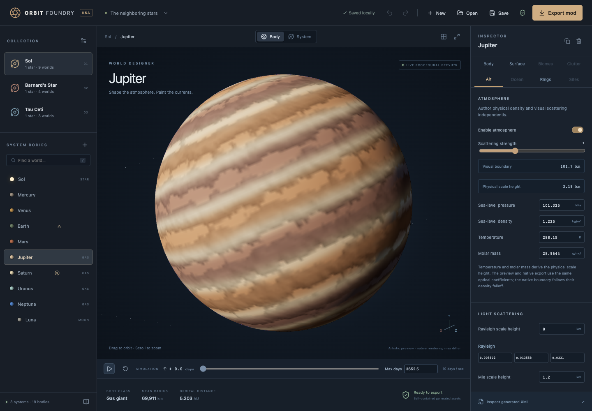

# Orbit Foundry

A browser-only solar-system authoring proof of concept for Kitten Space Agency. Design connected star systems, terrain biomes, cloud decks, oceans, surface clutter and launch sites; inspect them in Three.js and export a native KSA content mod with original generated assets.

The application has no backend, accounts, runtime CDN, game-file requirement, or network asset downloads. Its data model, procedural generator, format validator, and XML exporter also run under Node. The supplied `.agents/skills/ksa-modding/` knowledge base is retained as research material, not bundled into the app. Blender is only used to author the included stock models; using or exporting them does not require Blender.



## Run

Requires Node 22.12+ (verified with Node 24.18) and npm.

```sh
npm ci
npm run dev
```

Open `http://127.0.0.1:5173`. To build a portable static site:

```sh
npm run build
npm run preview
```

Serve `dist/` through any static HTTP server, at the origin root or in a subdirectory. Relative asset URLs are used. Opening `index.html` through `file://` is not supported by browser ES-module restrictions. Once the site has loaded, editing and export do not require network access. There is no service-worker installation or offline-reload guarantee.

## Author a collection

- **New** starts either a blank collection with one star and a rocky home world, or the Sol / Barnard’s Star / Tau Ceti starter. All changes can be undone.
- The left rail switches systems and selects bodies. **+** adds rocky or atmospheric worlds, gas giants, moons, companion stars, and additional systems. Adding a companion creates a native root barycenter and paired barycentric stellar orbits. Additional stars can be parented through the inspector.
- **Collection settings** edits the mod identifier, author, system names and ecliptic positions, galactic plane, and interstellar gas. It also removes entire systems. Deleting a system that contains home assigns the first surviving rocky world as home.
- **Body** edits stable native IDs, parent links, radius, mass, sphere of influence, full elliptical orbital elements, and rotation. Star controls include surface color, three independent sunlight channels, and root Cartesian position offsets. Root native position is system position plus local offset. Changing a body ID also updates child links.
- **Surface** edits seeded noise, warp, relief, lowland level, craters, gas belts and storms, color stops, and masked color occurrences. Occurrences remain independent from native terrain biomes.
- **Biomes** authors independent terrain regions with height, latitude, coverage and patch masks. Each region has separate ground and slope materials with generated diffuse, normal, roughness/metalness, displacement and height maps. The native ID/control cubemaps blend up to four regions at a sample; up to 32 biome definitions are supported.
- **Clutter** authors multiple independent populations. Choose procedural shapes or 25 original Blender specimens: rocks from pebbles to arches, dwarf and giant trees of different species, alien plants and static creatures, and Earth-like or alien ground cover. Each type has its own material, dimensions, density/distribution seed, patchiness, separation, scale range, orientation, biome membership, slope mask and altitude curve. Stock models have five distinct mesh LODs and 512px surface atlases, with needle/leaf cutouts where appropriate; colors remain editable. The isolated preview includes studio lighting and shadows.
- **Import GLB model** adds a static model with embedded PNG/JPEG textures to a clutter type. Mesh transforms and multiple materials are retained in the browser and native export; the converted geometry and textures travel with the saved project. Standard uncompressed metallic-roughness GLBs are supported within the displayed size limits. Unsupported features produce an actionable error. Imported models retain their full geometry at all five native LOD references; see [import details and limits](docs/research/imported-clutter.md).
- **Ground cover** includes meadow grass, dry bunchgrass, alien ribbon grass and a low spore mat. Selecting a specimen applies dense starting placement and a close terrain preview. Native materials include original thickness maps and Core-compatible foliage lighting settings. Grass remains normal biome-controlled clutter; no Core assets are required.
- **Clutter preview** offers **Selected asset**, **Entire library**, and **Terrain patch**. Patches range from 5–5,000 m with editable coordinates. Their summaries separate estimated eligible objects from the displayed sample. Ground cover can show up to 4,096 clumps; larger objects use smaller caps, with detail and instance count bounded to keep the preview practical. Placement remains an approximation of native GPU behavior.
- **Air** controls physical density/pressure, temperature and molar mass, native Rayleigh/Mie/ozone coefficients, scale heights, absorber profile and RGB anisotropy. Physical scale height is calculated from temperature, molar mass, and surface gravity; the visual boundary follows the native scattering equation. Optional original ambient audio combines wind, rumble and harmonic tones, with manual audition and a generated looping WAV.
- **Clouds** are authored from the Air controls: independent layers and cloud types, coverage, albedo, motion, flow, vertical shape/density curves and native raymarch settings. Generated mask, detail, color, normal and flow textures accompany full native cloud definitions. Gas giants receive atmospheric cloud decks as well as an underlying gas color map.
- **Ocean** adds native water to rocky worlds, with water level, color, transparency depth, wind waves, foam, and Gerstner waves. The preview shows coastlines against procedural terrain. Starter Earth and blank-collection Homeworld have oceans enabled. Ocean density keeps KSA’s working default because custom density has a loader bug in the current build.
- **Rings** controls radii, opacity, radial bands, palette, thickness, and seed. The native export includes volume settings and generated ring-rock meshes as well as textures.
- **Sites** adds named landmarks, cities, craters and mountains, plus launch pads with generated platform geometry, material maps and matching box colliders. Named cities/craters/mountains are coordinate markers, not generated structures or terrain features. Place pads on dry, gently sloping terrain; KSA does not flatten or drain a site automatically.
- **Place on planet** in Sites starts surface picking. The next left click on the actual terrain sets latitude/longitude and exits placement; Escape or **Cancel placement** cancels. Space, rings and atmosphere are not pick targets. Switching body or preview mode cancels placement, and the camera stays fixed while picking.
- **Body / System / Clutter** switches between the world, animated orbital overview and clutter preview. System view centers on the selected body and follows it during playback and time scrubbing. Drag to orbit around that body, scroll to zoom, and double-click another body to select it. **View options → Real scale** uses proportional physical body sizes and orbital distances in the selected system; it defaults off to retain the compressed overview. Small worlds may be invisible at a whole-system distance.
- **Max days** beside the simulation scrubber edits its time horizon, initially 3,652.5 days. Increase it to scrub through more orbital revolutions. Playback advances at 10 days/second and stops at the horizon; Play at the endpoint restarts from zero. Reducing the horizon clamps the current time.
- The **warning indicator** beside Export opens the collection’s warnings and validation errors. The current KSA build needs at least one enabled rocky-world ocean across the exported collection. Warnings remain exportable; invalid fields block export.
- **Save** downloads the complete `.orbit.json` project, including imported models and texture channels. **Open** restores it. IndexedDB autosaves projects beyond the small local-storage quota, with legacy project migration and a storage-error notice if saving fails. Keyboard shortcuts: Ctrl/⌘ S, Ctrl/⌘ Z, Shift Ctrl/⌘ Z, and Escape.

The starter is a design starting point, not a scientific or byte-identical recreation of Core. Barnard/Tau positions and planet sizes, masses, and orbits use the supplied current Core numeric definitions. The Sol starter contains the eight major planets and Luna with simplified orbital elements. Every terrain and atmosphere appearance is freshly authored procedural content. Tau Ceti g/h/f are candidate worlds in the reference data.

## Native mod export

**Export mod** validates the project and generates a ZIP entirely in the browser. The export contains one selectable `<System>` with all the editor’s system trees, allowing interstellar travel within that collection. It does not modify Core or patch an existing save.

```text
MyUniverse/
  mod.toml
  Systems/MyUniverse.xml
  PlanetMeshes.xml
  Assets.xml
  Textures/...
  Meshes/...
  Sounds/...              # when ambient audio is enabled
  project.json
  README.md
```

Generated content includes six-face KTX2 diffuse maps, R16 heightmaps, height-derived normals, Hapke scattering and surge maps, blended biome ID/control maps, independent terrain materials, cloud weather maps, ring/control PNGs, five-LOD GLB clutter, surface material atlases, distribution masks, physical launch pads, and optional PCM WAV audio. Meshes and materials use authored IDs; no celestial texture or model file is copied from Core or RealAtmospheres. The application verifies that every XML `Path` resolves to a file in the ZIP before packaging.

Extract the named folder under KSA’s user mods directory. Current source defines this as the platform’s personal/documents directory followed by `My Games/Kitten Space Agency/mods` (`KSA/Constants.cs:281`, `ModLibrary.cs:178`). Enable the mod through KSA’s mod controls or its user manifest, restart if required, and select the collection by its display name in the system selector. The native game and its normal Core engine resources must remain installed.

Resolution is per cubemap face, from 32 to 512 pixels. Bodies can override the collection setting, so a detailed home world need not make every distant moon expensive. Default 128px is useful for iteration. The upgraded Earth at 512px generated 42 assets / 55.1 MiB in 3.65 seconds in a Chromium measurement without preview GPU work; settings change this cost. Row-budgeted generation kept timer callbacks active, with a measured maximum 78ms gap. Exports generate bodies sequentially, report progress, and reject estimated source payloads above a conservative 384 MiB browser budget. This bounds the PoC; it is not an 8K production planet texture pipeline.

## Verification and limits

```sh
npm test              # model validation, assets, native XML and reference closure
npm run build         # strict TypeScript and production bundle
npm run test:browser  # Playwright authoring / save / reload / import / export / invalid inputs
```

Playwright uses installed Chromium. If needed, run `npx playwright install chromium` once. Its configuration starts a local development server when one is not already listening.

Automated checks parse exported XML, KTX2 and GLB structures, verify R16 cubemap face packing, PNG output, deterministic generation, mesh manifold winding, parent hierarchy, ZIP reference closure, imported project validation, undo/redo, and browser workflows. Source research is pinned to the supplied **KSA build 2026.10.10.5554**.

**Ocean compatibility:** the original defaults exposed KSA’s zero-byte ocean-culling buffer allocation because they contained no oceans. New defaults now export a real ocean referencing the generated mesh collection. Entirely dry collections show a warning explaining that this KSA build needs at least one ocean. Old project files preserve their existing content and import with oceans disabled; enable one through the Ocean tab. See the [diagnosis and implemented content correction](docs/research/ocean-buffer-startup-crash.md). The updated export has not yet been verified in-game; XML/container/browser checks do not establish native startup compatibility. Other boundaries:

- Three.js is a representative preview. Its original atmosphere shader approximates native Rayleigh/Mie phase functions, ozone absorption, sun attenuation and planet occlusion. Cloud shells use authored optical depth, profiles and flow; they do not reproduce flying through KSA's volumetric cloud renderer. Ocean optics use depth, moving wave normals and physical material lighting, without the native FFT simulation. Legacy atmosphere color/height fields remain import-compatible metadata and are no longer offered as native visual controls.
- Uncompressed RGBA normal maps are accepted by the texture loader, but the current CPU two-channel normal sampler only decodes BC5. CPU and GPU normal behavior may therefore differ.
- Biome maps represent at most four contributors at a texel. Changing the active set with more than four authored regions can sharpen boundaries. Detail height tiling/deformity fields exist in native XML but no physics reader was found; the R16 body heightmap remains authoritative terrain geometry. Lowland level controls the terrain datum; ocean level is independent. Ocean wind/color texture authoring, animated model import and vessel authoring remain outside this PoC.
- Generated and stock clutter uses distinct LOD geometry; imported GLBs reuse the full geometry at all five levels. Clutter exports collision disabled. Physical launch pads have colliders. Native clutter exclusion covers only the first four pads per body, and only the nearest pad collider within 300m is enabled per craft. The globe preview does not scatter life-size clutter across the entire planet.
- Original ambient sound follows native terrain-biome and pressure gating (at least 0.01 atmospheres at the camera). Per-biome audio layering is not authored; Core's empty `BiomeSounds` tag has no serializer in this build. Native audio and transitions still need in-game verification.
- Omitted optional features can use the native engine's default resources. Asset independence means no borrowed celestial textures/models; it does not replace Core shaders or the game runtime, and no RealAtmospheres shader patch is bundled.
- Native body IDs are their native names. Friendly editor names remain in `project.json`. The exported system’s display name is preserved. Orbit editing supports bound elliptical orbits, not hyperbolic/parabolic trajectories or n-body integration.
- Project import is the versioned authoring JSON, not an arbitrary existing KSA XML or mod importer. Export includes a project backup for round trips.

## Research and structure

- [Native format contracts](docs/research/game-format.md): exact serializers, hierarchy, units, stars, binary systems, atmospheres, rings, and native mod selection.
- [Generated assets](docs/research/assets.md): cubemap channels/containers, terrain material mapping, GLB requirements, and the procedural pipeline.
- [Runtime loader audit](docs/research/runtime-loader-audit.md): source-level fallback and asset-independence limits.
- [Ocean-buffer startup crash](docs/research/ocean-buffer-startup-crash.md): reported native failure, exact source chain, reproduced export comparison, and correction options.
- [Fidelity feature matrix](docs/research/fidelity-upgrade-plan.md): implemented native fields, migration and remaining boundaries.
- [Terrain, biomes and clutter](docs/research/surface-fidelity.md): shader channel contracts, coordinates, independent materials and real LODs.
- [Atmospheres, clouds and water](docs/research/atmosphere-fidelity.md): native weather fields, units, RealAtmospheres findings and preview approximations.
- [Surface locations](docs/research/surface-locations.md): named coordinates, generated launch pads and native collision/spawn limits.
- [Stock asset library](docs/research/stock-assets.md): original Blender sources, geometry, surface atlases and regeneration.
- [Grass and ground cover](docs/research/ground-cover.md): Core placement/material contract, original variants and dense previews.
- [Imported GLB clutter](docs/research/imported-clutter.md): supported materials, self-contained storage, native primitive mapping and import limits.
- [Environment audio](docs/research/environment-audio.md): original sound synthesis and native playback gates.
- [Independent validation audit](docs/validation-audit.md): bounded source/build review.
- [Architecture](docs/architecture.md): modules, coordinate conventions, and maintenance points.

Research sources are local sibling repositories, not application dependencies: `ksa-game-assemblies`, `ksa-linux`, `flexo`, and the older `pebkac`. No runtime asset is loaded from those folders.
