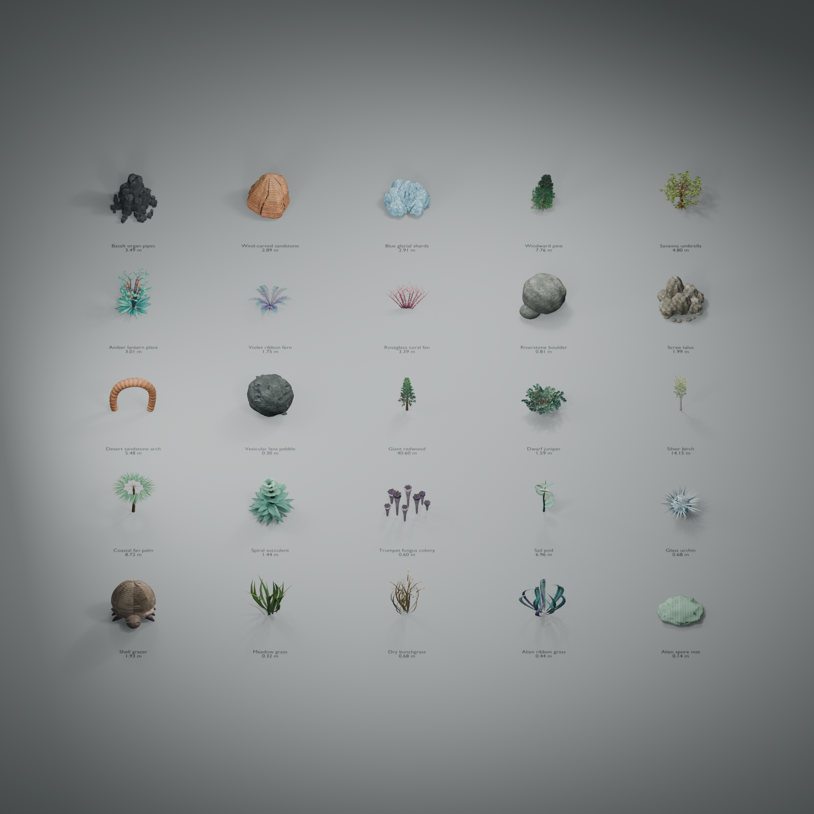

# Original Blender stock library

Created in Blender **5.2.2 LTS** using the Blender MCP on 2026-10-11. All meshes, palette colors and generation code were made for Orbit Foundry. There are no downloaded marketplace models, external textures, or Core/RealAtmospheres assets in this library. Blender is an authoring tool only; the application and its Node exporter do not require it at runtime.

| Stock asset           | Surface material details |
| --------------------- | ------------------------ |
| Basalt organ pipes    | Weathered mineral mottling, pits and broken fissures |
| Wind-carved sandstone | Warped sediment bands, pores and fine grit |
| Blue glacial shards   | Clouded mineral color and fine pale fractures |
| Windward pine         | Furrowed bark and varied needle surfaces |
| Savanna umbrella      | Bark, leaf midribs and branching veins |
| Amber lantern plant   | Fibrous stems, veined leaves and ribbed waxy pods |
| Violet ribbon fern    | Veined fronds with varied surface color |
| Roseglass coral fan   | Porous ridges and subtle polyp texture |

The library now contains 25 stock objects, each with five independently indexed native LODs. It includes small stones, large formations, low shrubs, canopy trees, a 40 m redwood, alien plants and static creatures, and four ground-cover variants. Creatures are scenery; no animation or AI behavior is exported. Trees combine solid trunks and branches with curved, crossed foliage cards. Their original needle and compound-leaf silhouettes are generated in the same atlas as their surface materials. Essential foliage cutouts and double-sided rendering are applied even to older saved projects that had opacity disabled. Users can change physical dimensions, material tint, roughness and placement just like other clutter. Ice remains opaque under the supported native clutter material; texture detail does not imply transmission or subsurface scattering.

## Expanded biome specimens

These 17 additions complement the eight detailed specimens above. Heights are design targets; the editor shows measured mesh bounds. All dimensions and population scale ranges remain editable.

| Specimen | Category | Nominal height | Form |
| --- | --- | ---: | --- |
| Riverstone boulder | rock | 0.8 m | A compact water-worn stone with weathered mineral grain. |
| Scree talus | rock | 2 m | A mixed pile of angular stones with dust-softened fracture edges. |
| Desert sandstone arch | rock | 6 m | An asymmetric eroded sandstone arch with a genuine open span. |
| Vesicular lava pebble | rock | 0.3 m | A small porous volcanic stone with modeled vesicles. |
| Giant redwood | tree | 40 m | A towering buttressed conifer with a narrow layered crown. |
| Dwarf juniper | tree | 1.8 m | A low twisted blue-green shrub with densely clustered needle shoots. |
| Silver birch | tree | 14 m | Pale forked trunks support a delicate crown of serrated leaves. |
| Coastal fan palm | tree | 9 m | A curved ringed trunk carries ribbed radial fan fronds. |
| Spiral succulent | alien | 1.4 m | A fleshy corkscrew rosette with overlapping waxy leaves. |
| Trumpet fungus colony | alien | 0.6 m | A small colony of fluted hollow fungal trumpets with curled rims. |
| Sail pod | alien | 7 m | Tall organic stems carry broad veined opaque sail membranes. |
| Glass urchin | alien | 0.7 m | A static radial ground creature with pale mineral-like spines. |
| Shell grazer | alien | 2 m | A static low alien creature beneath overlapping growth-ringed shell plates. |
| Meadow grass | groundcover | 0.3 m | A compact tuft of arching green grass blades. |
| Dry bunchgrass | groundcover | 0.7 m | A tall straw-colored tuft with slender seed-bearing stems. |
| Alien ribbon grass | groundcover | 0.45 m | Low curled teal blades with restrained violet edges. |
| Alien spore mat | groundcover | 0.12 m | A low living cushion with fine filaments and pale spore tips. |

Full palettes, deterministic builder mappings and surface metadata are recorded in `scripts/blender/stock_expansion_manifest.json` and `stock_expansion_geometry.py`. Ground cover selects close placement defaults, while every population can be assigned to an authored biome.

## Source and reproduction

- `assets/stock/orbit-foundry-field-specimens.blend` contains the current editable specimens, structural LODs and packed surface maps. `orbit-foundry-stock.blend` preserves the earlier prototype library. The scene was added separately without deleting existing user scenes.
- `scripts/blender/build_stock_library.py` rebuilds the mesh library with deterministic geometry seeds. Set its `ROOT` to the repository checkout when running it elsewhere. Run the file as a Blender script, or use `import runpy; runpy.run_path("/Users/asherwin/repos/meow-sci/poc-planets/scripts/blender/build_stock_library.py")["build_stock_library"]()` in Blender's Python console. It regenerates the shared material atlases, builds all 25 specimens and LOD sources, publishes the registry, renders the contact/category sheets and saves the scoped editable `.blend` file. The saved scene includes packed images and excludes unrelated live scenes. Gallery object transforms normalize display sizes; source mesh coordinates and exported bounds remain physical metres.
- `src/lib/stock-meshes.json` embeds five LODs per asset with indexed, quantized vertex data, original palette and metre dimensions. Each little-endian vertex record uses 16 bytes: unsigned 16-bit positions XYZ within the LOD bounds, signed normalized 16-bit normals XYZ, then unsigned normalized 16-bit UV. The vertex records are followed by unsigned 16-bit or 32-bit indices; the combined data is stored as base64. Position precision is one part in 65,535 of each axis bound. The browser and Node synchronously decode each LOD once, on first use.
- `scripts/generate-stock-textures.mjs [output-directory] [seed] [design-manifest]` writes the exact 512px atlas images for Blender authoring, using neutral selection defaults and seed 1 unless supplied. An optional design manifest lets Blender preview new species before their geometry enters the registry. Its default output is temporary; pack these images into the `.blend` instead of keeping duplicate PNGs. Blender image nodes must sample `(u,1-v)` while retaining the authored mesh UVs, because Blender interprets PNG top rows differently from the runtime. Diffuse is sRGB; normal and ORM are non-color data.
- `src/lib/stock-assets.ts` supplies browser/Node lookup, cached decoding and a bounded 32 MB material cache. `src/lib/stock-materials.ts` generates the original diffuse, tangent normal and occlusion/roughness/metalness atlases. Generated native GLBs are named per authored body/type and packaged with their own material atlases.

Blender's Z-up vertices and normals are rotated to the application's Y-up frame as `[x,z,-y]`. The native clutter export subsequently uses its established mesh contract. Each LOD has ground-relative positions and native-required geometry data. The stock adapter scales to the authored metre bounds, using inverse-transpose normals under unequal axis scales.

The semantic atlas has four columns and two rows. Slots 0–3 occupy UV v=0–0.5, and slots 4–7 occupy v=0.5–1. Slot 0 carries bark/stems/base material, slots 1–4 carry main foliage or stone, and slots 5–7 provide accents. Rocks use stone variations throughout. A local surface coordinate maps to `u=(column+0.02+0.96*localU)/4`, `v=(row+0.02+0.96*localV)/2`. The 2% tile inset and dilated edges reduce filtering bleed. Texture byte row zero maps to UV v=0 in both the browser's DataTexture and the native PNG; neither path flips it.

UVs follow the actual surfaces: around and along branches, across and along leaves, or over rock surfaces. Each triangle must retain a finite UV determinant above `1e-10` after quantization. This supports the native shader's derivative-based cotangent frame. Browser/GLB tangents are calculated from the same UVs, including mirrored handedness and unequal axis scaling.

Each asset can name a material family and foliage style. Needle, compound-leaf and serrated broadleaf silhouettes share the atlas contract, while birch bark, grass fibres, waxy succulents, fungal tissue and shell growth rings have their own original surface patterns. Ground-cover thickness maps use the native red-channel convention described in [ground-cover research](ground-cover.md).

Stock material textures use 512×512 pixels in both browser previews and native exports, independent of planet cubemap resolution. The original deterministic patterns combine several spatial scales: bark furrows, leaf veins, sandstone layers, mineral mottling and finer roughness variation. Normal maps derive from each tile's own relief without sampling neighboring tiles. The foliage PNG stores its mask in RGB (image alpha stays opaque); Blender connects its Color output to shader Alpha, not the constant image Alpha output. Foliage opacity also uses 512px and the same 0.4 alpha cutoff in both renderers. Bark/base and accent tiles stay opaque; foliage tiles 1–4 contain the silhouettes. Generated placement maps and optional non-stock opacity retain their independent lower resolutions (128px in browser previews; 64–256px for native export). Cached material pixels are reused when only placement changes.

The gallery image is a Blender presentation of the source objects. The editor's lighting, palette texture variation and game shaders can produce different appearances. GLB/data validation and browser inspection are separate from an actual KSA surface test.

## Authoring previews

The Clutter inspector provides **Selected asset**, **Entire library**, and **Terrain patch** views. The isolated view shows authored geometry dimensions even when its population is disabled, with neutral studio lighting, a ground plane and static soft shadows. Shadow maps update when the asset changes, not on every camera movement. The library arranges enabled types for comparison. The terrain patch displays the selected population at physical scale, with editable coordinates and a 5–5,000 m patch size.

The patch uses a sampled height field and the same generated distribution bitmap, biome memberships, altitude spline and slope mask as export. It also excludes underwater terrain, out-of-range candidates and the first four native launch-pad clearance areas. Native GPU tile jitter, mesh snapping and hashing are approximated. Counts distinguish the expected eligible population from the random rendered realization, with up to 256 larger objects or 4,096 lightweight ground-cover clumps drawn. Mesh detail and, where necessary, instance counts are reduced to keep the preview workload bounded. An estimate can differ slightly from the sampled count even below that cap.

Current browser close-ups and 5 m / 20 m ground-cover patches are in `docs/screenshots/stock-detail/`, with a machine-readable report of triangle counts, texture sizes, population estimates and browser errors. Reproduce them with `STOCK_URL=http://127.0.0.1:5173 node scripts/capture-stock-models.mjs`. Earlier [library](../screenshots/stock-library.png) and [scatter](../screenshots/clutter-scatter.png) images record the prototype and are retained as historical comparisons.
